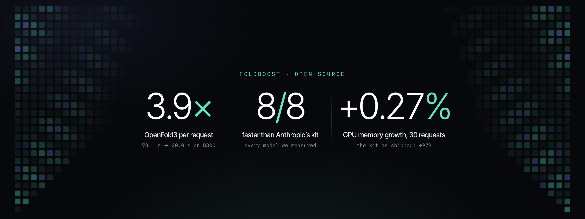
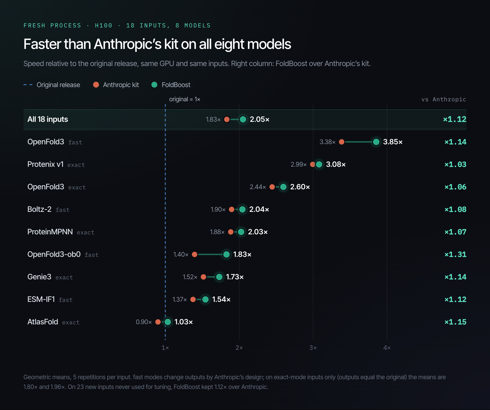
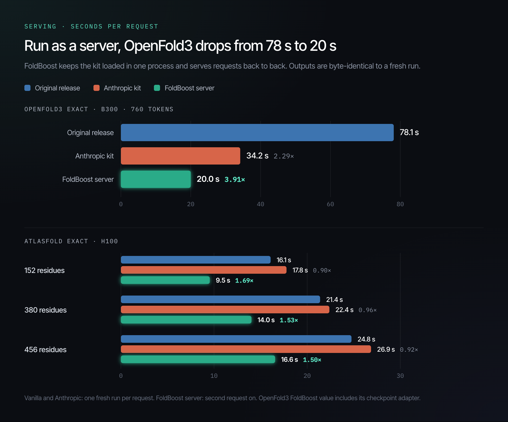
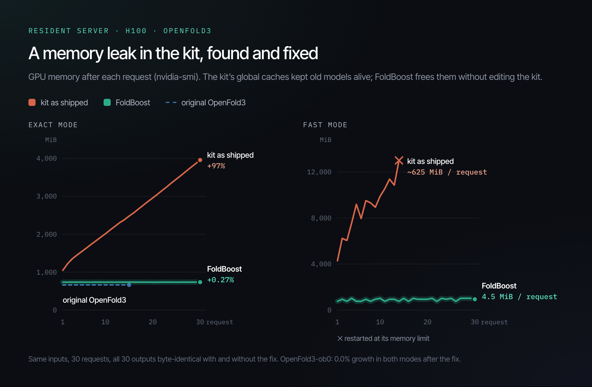

# FoldBoost

<p align="center">
  
</p>

**FoldBoost makes biomolecular model inference faster than Anthropic's optimization kit.** Anthropic's [uplifting-biomolecular-modeling](https://github.com/anthropics/uplifting-biomolecular-modeling) kit runs 36 models (OpenFold3, Boltz-2, Protenix, ProteinMPNN and more) several times faster than their original releases. FoldBoost, by [AI3](https://ai3discovery.com), sits on top of it and goes further:

* **Faster than Anthropic's kit on all 8 models we benchmarked**, with outputs byte-identical to Anthropic's kit in the same mode.
* **As a server, one OpenFold3 request on a B300 takes 20.0 s**, against 34.2 s with Anthropic's kit and 78.1 s with the original release.
* **A GPU memory leak in the kit, found and fixed** from the outside: +97% → +0.27% over 30 requests on a resident OpenFold3 server.

Blog post: [EN](https://ai3discovery.com/research/foldboost-open-source-biomolecular-inference) · [KO](https://ai3discovery.com/ko/research/foldboost-open-source-biomolecular-inference-ko)

## Results

**Fresh process, one run, H100** — speed relative to the original release; 18 inputs, 8 models, 5 repetitions per input:

| Model · mode | Original | Anthropic's kit | FoldBoost | FoldBoost vs Anthropic |
|---|---:|---:|---:|---:|
| OpenFold3 · fast † | 1.00× | 3.38× | **3.85×** | 1.14× |
| Protenix v1 · exact | 1.00× | 2.99× | **3.08×** | 1.03× |
| OpenFold3 · exact | 1.00× | 2.44× | **2.60×** | 1.06× |
| Boltz-2 · fast † | 1.00× | 1.90× | **2.04×** | 1.08× |
| ProteinMPNN · exact | 1.00× | 1.88× | **2.03×** | 1.07× |
| OpenFold3-ob0 · fast † | 1.00× | 1.40× | **1.83×** | 1.31× |
| Genie3 · exact | 1.00× | 1.52× | **1.73×** | 1.14× |
| ESM-IF1 · fast † | 1.00× | 1.37× | **1.54×** | 1.12× |
| AtlasFold · exact \* | 1.00× | 0.90× | **1.03×** | 1.15× |
| **All 18 inputs (geometric mean)** | 1.00× | **1.83×** | **2.05×** | **1.12×** |

† `fast` modes change outputs by Anthropic's design, so the original column is speed only; on exact-mode inputs alone (outputs equal the original, 10 inputs) the means are 1.80× and 1.96×. \* Anthropic's exact mode is slower than the original for AtlasFold; the router knows this and picks the faster path. On 23 inputs never used for tuning FoldBoost kept its lead (geometric mean 1.12× over Anthropic).



**As a server** — the kit's own function kept loaded in one process, second request on, outputs byte-identical to a fresh run:

| Configuration | vs Anthropic's kit (fresh CLI) | vs original |
|---|---:|---:|
| OpenFold3 exact, B300, 760 tokens | 1.71× (34.2 s → 20.0 s, with the checkpoint adapter) | **3.9×** (78.1 s → 20.0 s) |
| OpenFold3 exact, B300 | 1.45–1.58× (1.61–1.80× with the adapter) | — |
| OpenFold3 exact, H100 | 1.37–1.49× | — |
| OpenFold3 fast, H100 | 1.61–1.82× (1.76× over 30 requests with the memory release) | — |
| AtlasFold exact, H100 | 1.62–1.97× | 1.50–1.69× |
| OpenFold3-ob0 exact, B300 (quick look) | 1.85–1.99× | — |
| Boltz-2 fast, H100 | 1.09–1.11× | — |



### A memory leak in the kit, found and fixed

On an H100, a resident OpenFold3 server grew GPU memory by about 97 MiB per request (+97% over requests 10–30). Upstream OpenFold3 called the same way stays flat; the growth comes from the kit's `of3_transition._PACKS` cache, which keeps packed weights for every module it has seen. A command-line run exits and never notices; a server piles it up. `serve_kit.install_leak_guards` frees each pack when its module dies, without editing the kit: **+97% → +0.27%**, 30/30 outputs byte-identical, speed kept (1.45× end to end through the router).

The `fast` mode leaked in more places (about 625 MiB per request): the kit's item-boundary release hooks never run in a process that builds a model per request, and two caches hold each other through module-global registries. `serve_kit.release_kit_levers` calls those hooks and breaks the cycles: 4.5 MiB per request, flat over 30 requests, outputs byte-identical, 1.76× faster than a fresh CLI. OpenFold3-ob0 gets the same release in both modes and is flat on H100 (0.0%, 30 requests). Details and a patch for the kit itself: [docs/KIT_FINDINGS.md](docs/KIT_FINDINGS.md), [docs/kit-patches/of3_transition_packs.diff](docs/kit-patches/of3_transition_packs.diff).



## How it works

1. **Router.** For each request it reads archived measurements and picks the fastest of the original release, Anthropic's mode and a FoldBoost adapter. It never switches `exact` and `fast`, and sends inputs it has not measured to Anthropic's mode.
2. **Resident server.** It keeps the kit's own entry point loaded in one process and serves requests back to back, so imports, GPU initialization and checkpoint loading are paid once. The memory release above lives here.
3. **Eight adapters.** They remove per-process costs (checkpoint loading, a Triton fingerprint, a CIF parser, worker start-up). Each is byte-checked against the kit's output and refused if a single byte differs.

Model code is not touched. FoldBoost wraps Anthropic's kit as it is ([pinned commit `f4f62fa`](https://github.com/anthropics/uplifting-biomolecular-modeling/tree/f4f62fa6592ae4938d49b1757bea0cfeff9f468e)).

## Quick start

```sh
git clone https://github.com/ai3inc/foldboost.git && cd foldboost
python -m foldboost verify          # checks the policy digest and the 8 adapters
python -m foldboost coverage        # what is supported, per model
python -m foldboost install-gate --python /opt/venv/bin/python   # once per kit environment
python -m foldboost run --kit genie3 --kit-dir /kit/genie3 --python /opt/venv/bin/python -- design --config h100 --mode exact ...
```

Serving, policies and every command: [HYBRID.md](HYBRID.md).

## What is in this repository

* `foldboost/` — the router (`python -m foldboost select|run|verify|coverage|install-gate|serve`), the resident server, the digest-checked policy and the 8 vendored adapters. The adapters are byte-identical copies of the files that were measured, so their internal names (`flashpair_bootstrap`, `FLASHP_*`) are part of the checked bytes and are not renamed.
* `tools/` — policy builders, holdout analysis, report generator, figures (`tools/figures/make_figures.py`, data from `tools/export_figure_data.py`), RunPod controller.
* `docs/` — [KIT_FINDINGS.md](docs/KIT_FINDINGS.md), the kit patch, figures and their data (`docs/data/figure-data.json`).
* `HOLDOUT_PLAN.json` — the measurement plans, written before measuring, and their amendments.
* `BENCHMARK_REPORT.html` — every measured row (Korean labels).
* `tests/` — 44 CPU tests (`python -m unittest discover -s tests`); GPU speed is measured separately, as above.

## How we measured

Every number compares the original release, Anthropic's kit and FoldBoost side by side on the same GPU with the same inputs (H100 and B300), as whole-process time or request latency. Plans and pass criteria were written before measuring.

* Of the 36 kits, 8 have the full three-way measurement with an unseen-input holdout, 27 a quick look (original, Anthropic, resident) and 1 (Protenix v2) could not be measured because its weights are not accessible.
* The resident server helps where the kit runs the model in-process (OpenFold3, AtlasFold, OpenFold3-ob0). Kits that start a child process per request (Genie3, ESM-IF1, chai1, AlphaFold 3 and others) gain about 1.0× from it; ProteinMPNN, Protenix, gpnstar, Enformer, Borzoi and Evo2 cannot be served resident.
* Anthropic's exact mode is slower than the original for AtlasFold and gpnstar, and some gains need the kit's JIT cache to be warm. On B300 the kit refuses OpenFold3 `fast`, and the router serves OpenFold3-ob0 resident on B300 only until it has its own H100 holdout.
* One pre-registered rule was changed after the data (Genie3, one stalled repetition) and one sub-check of the memory study (torch-reserved memory 4 → 6 MiB) is not met; both are reported in `HOLDOUT_PLAN.json` and `BENCHMARK_REPORT.html`.

## Attribution and license

Apache-2.0; see [LICENSE](LICENSE) and [NOTICE](NOTICE). The kits, their modes and the common runtime are Anthropic's ([uplifting-biomolecular-modeling](https://github.com/anthropics/uplifting-biomolecular-modeling), Apache-2.0; [announcement](https://www.anthropic.com/research/claude-uplifts-biomolecular-modeling)). FoldBoost is an independent project by AI3 and is not affiliated with or endorsed by Anthropic.

<details>
<summary>한국어 요약</summary>

FoldBoost는 Anthropic의 바이오 모델 추론 키트보다 빠르게 바이오 분자 모델을 돌리는 AI3의 오픈소스입니다. Anthropic 키트(36개 모델을 원본보다 몇 배 빠르게 돌림) 위에 라우터, 상주 서버, 어댑터 8개를 얹었습니다. 측정한 8개 모델 모두에서 Anthropic 키트보다 빠르고(입력 18개 평균: 원본 대비 Anthropic 1.83배, FoldBoost 2.05배), 출력은 같은 모드의 Anthropic 키트와 바이트 단위로 같습니다. 서버로 띄우면 B300에서 OpenFold3 요청 한 건이 원본 78.1초, Anthropic 키트 34.2초, FoldBoost 20.0초입니다. 상주 서버에서 Anthropic 키트의 GPU 메모리 누수를 찾아 키트를 고치지 않고 막았습니다(30요청 동안 +97% → +0.27%). 블로그: [한국어](https://ai3discovery.com/ko/research/foldboost-open-source-biomolecular-inference-ko)

</details>
